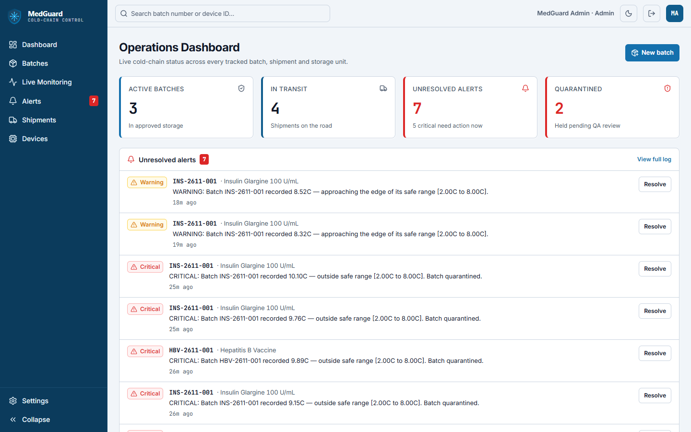
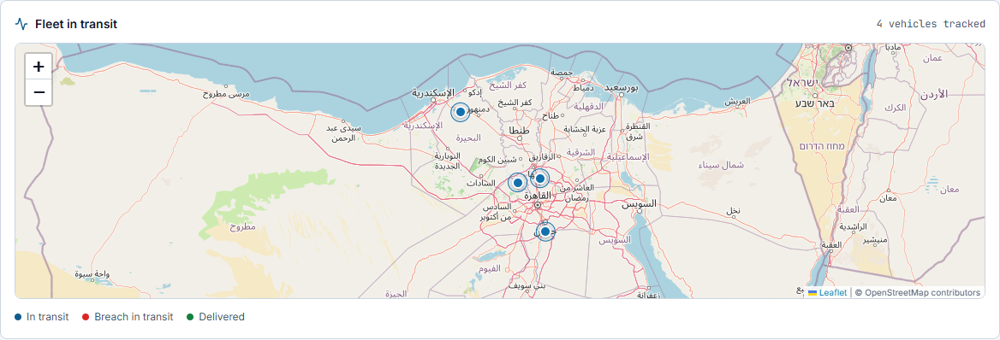
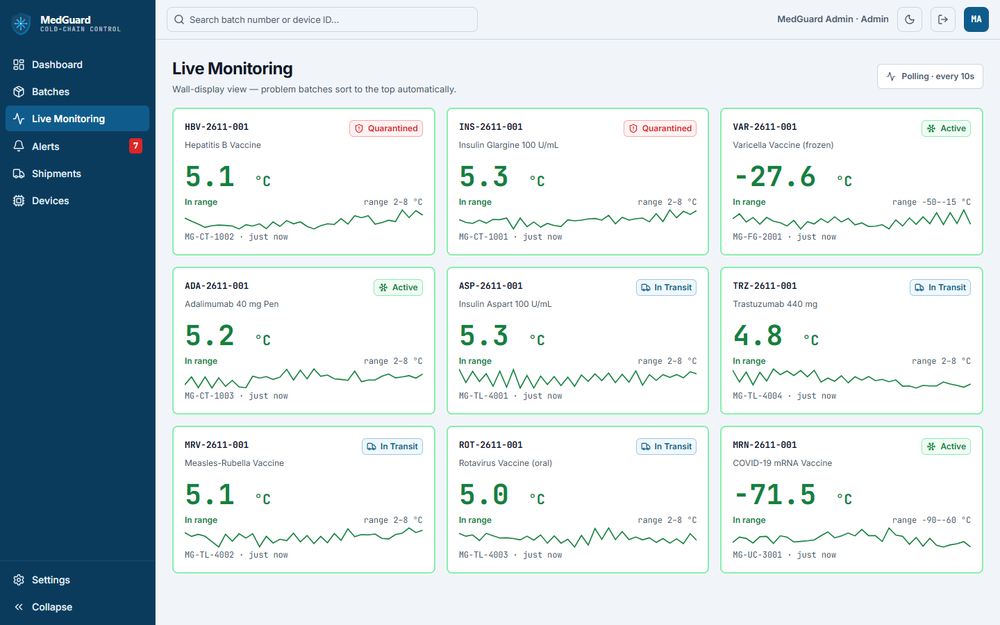
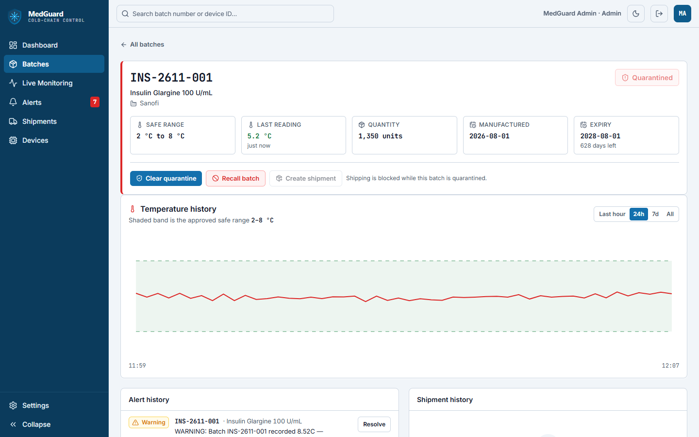
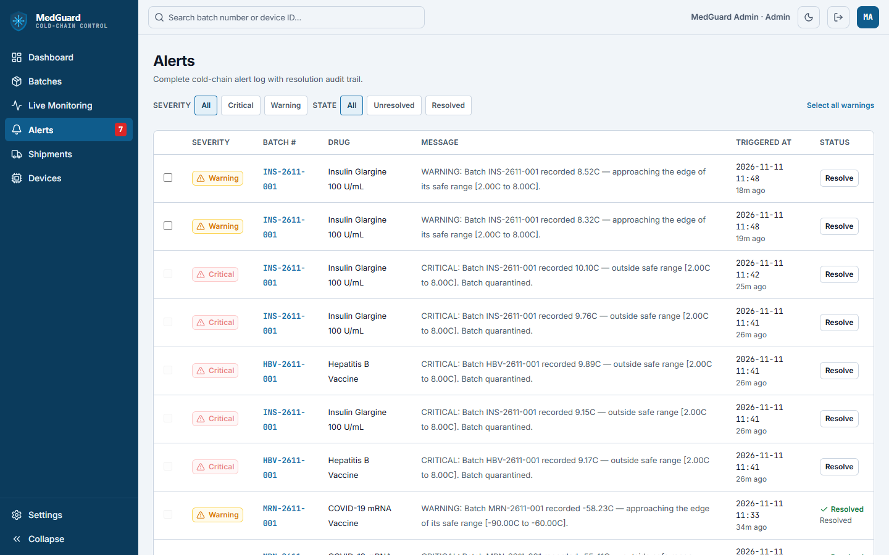
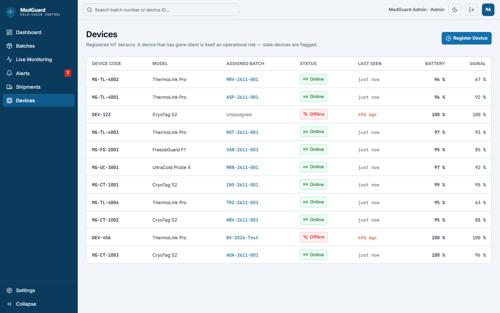
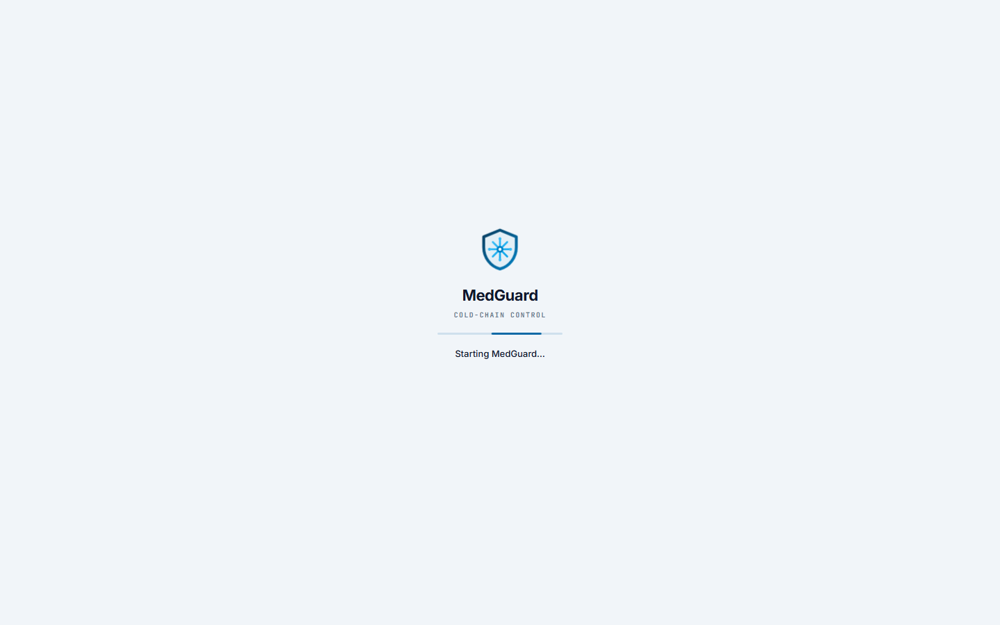

<div align="center">

# 🧊 MedGuard
### Pharmaceutical Cold-Chain & Medication Traceability Platform

A cold-chain monitoring platform built with **ASP.NET Core**, **EF Core**, **SQL Server**, and **Angular** to track medication batches from manufacturer to pharmacy, detect temperature breaches the instant they happen, and automatically quarantine affected stock before it reaches a patient.

---


**Status:** Complete and running end-to-end. Every Angular page (Dashboard with live
fleet map, Batches, Batch Detail, Live Monitoring, Alerts, Shipments, Devices, Settings)
works against the real, authenticated API. Telemetry flows MQTT → Kafka → SQL, with
alerts pushed live over SignalR. The public demo is fed around the clock by a simulated
sensor fleet, so it always shows live data.

**Live demo:** https://medguardd.vercel.app · sign in as `admin@medguard.local` / `Demo@123`<br>
**Self-hosted (full pipeline):** https://medguard.dpdns.org

</div>

---

# 📖 Overview

In Egypt — and developing countries generally — cold-chain failure for medication is a
real, under-reported risk. A two-hour power cut at a warehouse, or a delivery vehicle
without working refrigeration, can silently ruin an entire batch of vaccines or insulin,
with nobody finding out until it's already been administered. The WHO has documented
this as a systemic problem, and it hits rural distribution networks hardest, where
cold-chain monitoring is often manual or nonexistent.

MedGuard closes that gap: every sensor reading is checked against a batch's safe
temperature range the moment it arrives. A small breach raises a warning. A large
breach raises a critical alert **and automatically quarantines the batch**, blocking
it from being shipped until a human resolves the alert.

---

# 🚀 Key Features

## 🌡️ Cold-Chain Monitoring

- Every sensor reading (temperature, humidity, GPS) is evaluated against the
  batch's safe range on ingestion — no batch job, no delay
- Two-tier breach severity: `Warning` (approaching the edge of the safe range)
  vs. `Critical` (outside it)
- **Automatic quarantine** on critical breach — enforced inside the `Batch`
  aggregate itself, so it cannot be bypassed by any code path that records a
  reading
- Full sensor-reading history per batch

## 📦 Batch Traceability

- Register a batch with drug name, manufacturer, quantity, expiry and a safe
  temperature range
- One call returns a batch's full picture: recent readings, alerts, and
  shipment history together
- Status lifecycle enforced by the domain: `Active → InTransit → Delivered`,
  with `Quarantined`/`Recalled` as guarded side branches — illegal transitions
  (e.g. shipping a quarantined batch) are rejected at the domain layer, not
  patched over in a controller

## 🚨 Alerting

- Unresolved-alerts feed, resolved server-side (a resolution is a persisted
  fact — not client-side UI state that disappears when you change page)
- Paginated, filterable alert log by severity/resolved status
- Critical-alert resolution requires explicit confirmation in the UI —
  resolving cold-chain-breach alerts isn't a one-click, undo-able action

## 🚚 Shipment Tracking

- Ship a batch (blocked while quarantined or recalled — enforced by the
  aggregate)
- Mark a shipment delivered
- Full shipment log across every batch, plus per-batch shipment history

## 📡 Device Management

- Register an IoT sensor device
- Heartbeat endpoint (battery %, signal %) — device status
  (`Online` / `Stale` / `Offline`) is **derived from time-since-last-heartbeat**
  on every read, never stored, so a device can't silently stay "online" in the
  database after it's gone dark
- Assign / unassign a device to a batch

## 🖥️ Live Operations Dashboard (Angular)

- KPI cards (active batches, in-transit, unresolved alerts, quarantined) fed
  from the real API
- Unresolved-alert feed with resolve actions and critical-alert confirmation
- **Fleet in transit** map (see below)
- Recent-batches table with live status and each batch's latest reading
- A startup screen that covers the sign-in round trip ("Starting MedGuard…",
  "Redirecting to secure sign-in…", "Signing you in…"), explains a slow first
  visit on free hosting, and offers a retry if IdentityServer is unreachable,
  instead of a blank page

## 🚚 Fleet Tracking

- Leaflet/OpenStreetMap map of every truck on the road, at the position its
  sensor last reported (GPS rides on every sensor reading)
- Each truck's recent GPS trail, plus a geofence halo around its position
- Colour = cold-chain state: **in transit**, **breach in transit** (critical
  reading, open critical alert or quarantined) and **delivered** (last 24 h)
- Hover for batch, drug, route, courier and live temperature; click to open the
  batch. Refreshes every 30 s without resetting your zoom
- No vehicle table: a truck *is* its shipment's sensor, so the fleet is derived
  from shipments + readings the API already has

## 📡 Live Monitoring

- Wall-display card grid of every batch currently in storage or transit
- **Pushed live over SignalR** when Kafka is running (self-hosted stack,
  [ADR 0007](medguard-backend/docs/adr/0007-realtime-monitoring-feed.md));
  falls back to polling every 10 seconds otherwise (the Vercel/runasp demo)
- Problem batches sort to the top: live critical readings, then quarantined
  batches (still held after their temperature recovers), then warnings
- Per-batch sparkline trend and current reading, derived from the same sensor
  history the batch detail chart uses

## ⚙️ Settings — org-configurable, not decorative

- Organization profile, cold-chain thresholds and alert routing are real,
  persisted, and editable — not the read-only mock the original design shipped
  with
- Two settings actually drive live domain behavior: **Warning margin %**
  (replaces a hardcoded tolerance in `Batch.RecordReading` with a
  percentage-of-safe-range calculation) and **Auto-quarantine on breach** (a
  real on/off switch on the aggregate's quarantine call) — plus **Device
  silent after** controls when a device's derived status flips to Stale

---

# ⚙️ Telemetry Pipeline

Two ingestion paths, one set of rules: both end in the same
`ColdChainMonitoringService` → `Batch.RecordReading()`.

```
IoT sensor ──MQTT (QoS 1, LWT)──► HiveMQ ──► IngestionBridge ──► Kafka "sensor-readings"
                                                                      │  keyed by BatchId
                                                                      ▼
Sensor gateway ──HTTP POST /api/sensorreadings──┐         Monitoring.Worker (batched, idempotent)
                                                ▼                     │
                                   ColdChainMonitoringService ◄───────┘
                                                │
                                   Batch.RecordReading()  ← domain aggregate, owns the safety invariant
                                                │
              ├── within range ──────────► stored, nothing else happens
              ├── small breach ──────────► Warning alert
              └── large breach ──────────► Critical alert + batch auto-quarantined
                                                │
                       SQL Server (reading + alert + outbox row in ONE transaction)
                                                │
                     OutboxDispatcher ──► Kafka "batch-alerts" ──► API KafkaNotifier ──► SignalR ──► Angular
```

The self-hosted stack runs the whole thing. The hosted demo (runasp.net) has no
broker, so its sensors use the HTTP path and the browser polls
([ADR 0001](medguard-backend/docs/adr/0001-mqtt-kafka-telemetry-ingestion.md)).

---

# 🏛 Architecture — Clean Architecture (4 layers, no CQRS)

```
MedGuard
│
├── MedGuard.API              → Controllers, Program.cs, appsettings (composition root)
│         ↓ depends on
├── MedGuard.Infrastructure   → EF Core, DbContext, Repositories, migrations
│         ↓ depends on
├── MedGuard.Application      → Services (business logic), DTOs, interfaces
│         ↓ depends on
└── MedGuard.Domain           → Entities, enums, repository interfaces (zero external deps)
```

**Dependency rule: inner layers never reference outer layers.** `Domain` doesn't know
EF Core exists. `Application` doesn't know SQL Server exists — it only talks to
`IUnitOfWork` / repository interfaces defined in `Domain`. `Infrastructure` implements
those interfaces. `API` wires everything together in `Program.cs`.

Around that core, each process is its own project:

| Project | Role |
|---|---|
| `MedGuard.IdentityServer` | Duende IdentityServer: OIDC login, tokens |
| `MedGuard.IngestionBridge` | MQTT → Kafka, acks the device only after Kafka has the record ([ADR 0004](medguard-backend/docs/adr/0004-mqtt-kafka-bridge.md)) |
| `MedGuard.Monitoring.Worker` | Kafka → domain → SQL, batched and idempotent, plus the outbox dispatcher ([ADR 0005](medguard-backend/docs/adr/0005-monitoring-consumer.md), [0006](medguard-backend/docs/adr/0006-transactional-outbox.md), [0008](medguard-backend/docs/adr/0008-load-test-and-scaling.md)) |
| `MedGuard.DeviceSimulator` | Fake sensors over MQTT (load tests), or the HTTP demo fleet ([below](#-live-demo--data-simulation)) |
| `MedGuard.Contracts` | Message contracts, topic names, trace propagation shared by every service |
| `MedGuard.ServiceDefaults` | Serilog, OpenTelemetry, health checks: one call per service ([ADR 0010](medguard-backend/docs/adr/0010-resilience-and-health.md), [0011](medguard-backend/docs/adr/0011-observability.md)) |

The domain itself is a monolith on purpose. The service boundaries in the
[Roadmap](#-roadmap) already exist as clean, independently-testable layers inside it —
splitting them out later is a refactor, not a rewrite.

---

# 💾 Data Storage

Currently a single **SQL Server** database via EF Core, storing:

- Batches, sensor readings, alerts, shipments, devices
- Full relational history — every reading and every alert a batch has ever
  had, queryable per-batch in one round trip
- The transactional outbox (`OutboxMessages`), so an alert and its event are
  committed together
- Every timestamp is UTC and leaves the API with a `Z`
- For long-running demos on a small hosted database,
  [`loadtest/demo-prune.sql`](medguard-backend/loadtest/demo-prune.sql) keeps 48 h
  of readings (and every reading an alert points at)

A dedicated time-series store (TimescaleDB) for high-volume telemetry is
planned once ingestion volume moves past what a relational table comfortably
handles at scale — see [Roadmap](#-roadmap).

---

# 🛠 Tech Stack

| Category | Technology |
|-----------|------------|
| Backend | ASP.NET Core (.NET 8) |
| Architecture | Clean Architecture (Domain / Application / Infrastructure / API) |
| Database | SQL Server (EF Core, code-first migrations) |
| Identity | Duende IdentityServer — OAuth2/OIDC, Authorization Code + PKCE |
| Frontend | Angular 22 — standalone components, zoneless change detection, signals |
| Styling | Tailwind CSS |
| Icons | Lucide |
| Maps | Leaflet + OpenStreetMap |
| Messaging | MQTT v5 (HiveMQ, MQTTnet) at the edge, Apache Kafka in the backend |
| Real-time | SignalR |
| Observability | Serilog + Seq, OpenTelemetry, Prometheus + Grafana |
| Tests | xUnit, Testcontainers (SQL Server + Kafka), GitHub Actions |
| Hosting | Docker Compose + Cloudflare Tunnel (self-hosted); Vercel + runasp.net (demo) |
| API contract | Consistent `Response<T>` envelope across every endpoint |

---

# 🔒 Security

MedGuard.API is an OAuth2 resource server: every endpoint requires a valid JWT
access token (checked at `BaseApiController` level, so new controllers are locked
down by default rather than by remembering to add `[Authorize]`), except ones
explicitly opted out with `[AllowAnonymous]` — currently just the device heartbeat
endpoint, which a physical sensor gateway calls and will get its own per-device key
scheme later.

**MedGuard.IdentityServer** — a Duende IdentityServer instance, run as its own
ASP.NET Core project — issues the tokens:
- Angular authenticates via **Authorization Code + PKCE**, the only OIDC flow
  considered safe for a browser-based SPA (no client secret embedded in JS)
- A separate `client_credentials` client (`medguard-m2m`) for service-to-service
  calls: health checks, sensor gateways, the demo fleet. Its secret comes from
  `M2M:ClientSecret`; set it on every public deployment (the built-in default
  is for local development only)
- Two seeded demo accounts for now (`admin@medguard.local` / `operator@medguard.local`,
  password `Demo@123`) via Duende's in-memory test-user store — not a real user
  database yet; see [Roadmap](#-roadmap)

Rate limiting and secrets management (beyond `appsettings.json`) are still open
items — see [Roadmap](#-roadmap).

---

# ▶️ Running Locally

Three processes, in this order:

```bash
# 1. IdentityServer (issues tokens) — https://localhost:5001
cd medguard-backend/src/MedGuard.IdentityServer && dotnet run

# 2. API (resource server) — http://localhost:7591
cd medguard-backend/src/MedGuard.API && dotnet run --urls "http://localhost:7591"

# 3. Angular app — http://localhost:4200
cd medguard-angular && npm install && npm start
```

Opening `http://localhost:4200` shows the startup screen, then IdentityServer's login page.

To fill it with live data, run the demo fleet against your local API (see
[Live demo & data simulation](#-live-demo--data-simulation)):

```bash
cd medguard-backend/src/MedGuard.DeviceSimulator
dotnet run -- demo --Demo:ApiBaseUrl=http://localhost:7591 --Demo:Authority=https://localhost:5001
```
Demo accounts (seeded test users, not a real user database yet):

| Username | Password | Role |
|---|---|---|
| `admin@medguard.local` | `Demo@123` | Admin |
| `operator@medguard.local` | `Demo@123` | Operator |

---

# 🎬 Live Demo & Data Simulation

| | URL |
|---|---|
| Dashboard (Angular, Vercel) | https://medguardd.vercel.app |
| API (runasp.net) | https://medguard.runasp.net · `/health/ready` |
| IdentityServer (runasp.net) | https://medguard-identity.runasp.net |
| Database | SQL Server (databaseasp.net) |

Demo accounts: `admin@medguard.local` / `operator@medguard.local`, password `Demo@123`.

The data on it is generated live by `MedGuard.DeviceSimulator`'s **`demo` mode**: a
fleet of simulated sensors that talks to the deployed API exactly like real sensor
gateways do. Every reading goes through `POST /api/sensorreadings` and the domain,
so the alerts, quarantines and deliveries you see are real system behaviour, not
seeded rows.

- **Seeds itself** (idempotent): 9 sensors on realistic batches. Five sit in
  warehouses (insulin, Hepatitis B and Adalimumab at 2–8 °C, a frozen varicella
  vaccine at −50…−15 °C, an mRNA vaccine at −90…−60 °C). Four ThermoLink trucks
  drive real Egyptian routes (Cairo → Alexandria, Cairo → Aswan,
  Alexandria → Tanta, Giza → Mansoura).
- **Readings every 20 s** per sensor with GPS (moving along the route for trucks)
  and humidity. Heartbeats keep devices *Online*.
- **Realistic temperature**: a mean-reverting walk around each unit's setpoint,
  scaled to the batch's safe range. Occasional excursions (a door left open, a
  power cut) are either *mild* (Warning) or *severe* (Critical + auto-quarantine).
  One critical excursion starts about a minute after launch, so a fresh demo has
  something to show.
- **Trips finish**: on arrival the shipment is delivered, and the truck picks up
  a new batch at a hub and leaves on a new route.
- **A simulated QA operator** resolves demo alerts after 30 minutes (long enough
  to show and resolve them yourself) and releases recovered storage batches from
  quarantine. It never touches batches you create.
- **Stateless**: it rebuilds the fleet from the API on start, so stopping and
  restarting just continues.

```bash
cd medguard-backend/src/MedGuard.DeviceSimulator
dotnet run -c Release -- demo                                # seed if needed, then run
dotnet run -c Release -- demo --Simulation:Quiet=true        # summaries and alerts only
dotnet run -c Release -- demo-seed                           # only create the fleet
dotnet run -c Release -- demo --Demo:ClientSecret=<secret>   # a non-default M2M secret
```

Knobs (the `Demo` section of `appsettings.json`, or `--Demo:<Name>=`): `ApiBaseUrl`,
`Authority`, `ClientSecret`, `IntervalSeconds` (20), `ExcursionsPerHour` (0.3 per
sensor), `StorageSevereShare` / `TransitSevereShare`, `TransitSpeedKmh` (70),
`KickoffExcursion`, `AutoResolveAfterMinutes` (30, 0 = off). At the defaults the
database grows by roughly 8 MB a day; run
[`demo-prune.sql`](medguard-backend/loadtest/demo-prune.sql) on a schedule to cap it.

---

# 🐳 Docker & Deployment

The whole application runs in containers ([`docker-compose.yml`](docker-compose.yml),
one multi-stage [`Dockerfile`](Dockerfile)):

| Container | What |
|---|---|
| `api` | MedGuard.API on **Kestrel**, also serving the Angular SPA from `wwwroot` |
| `identity` | Duende IdentityServer on **Kestrel**, under `/identity` |
| `ingestion-bridge`, `monitoring-worker` | the MQTT → Kafka → SQL pipeline |
| `edge` | nginx path router: `/identity/` → identity, everything else → api |
| `cloudflared` | Cloudflare Tunnel connector (production, `tunnel` profile) |
| `migrator` | applies EF Core migrations once, then exits |
| `sqlserver`, `kafka` (+ `kafka-init`), `hivemq` | infrastructure |
| `grafana`, `prometheus`, `seq`, `kafka-ui`, `mqtt-web` | ops tools (`--profile ops`), each on its own sub-domain behind basic auth |
| `simulator`, `kafkalab` | opt-in (`--profile simulator` / `--profile tools`) |

```bash
cp .env.example .env          # set the secrets (and the "Local run" origins)
docker compose up -d --build  # then open http://localhost:8088
```

**Production** — **https://medguard.dpdns.org**, through a Cloudflare Tunnel: Cloudflare
terminates HTTPS and forwards over the tunnel to `cloudflared` → `edge`
([`deploy/nginx/edge.conf`](deploy/nginx/edge.conf)), so no inbound port is open on the
server, and SPA, API and IdentityServer share one origin.

| URL | What |
|---|---|
| https://medguard.dpdns.org | the dashboard (Angular) + REST API + SignalR |
| https://medguard.dpdns.org/identity/ | IdentityServer (login, session, permissions) |
| https://medguard.dpdns.org/swagger | API explorer ("Authorize" signs in via IdentityServer) |
| https://grafana.medguard.dpdns.org | pipeline dashboards |
| https://kafka.medguard.dpdns.org | Kafka UI: topics, messages, consumer lag (read-only) |
| https://hivemq.medguard.dpdns.org | MQTT web client; broker at `wss://hivemq.medguard.dpdns.org/mqtt` |
| https://seq.medguard.dpdns.org | logs and traces of every service |
| https://prometheus.medguard.dpdns.org | raw metrics |

The tool sub-domains share one basic-auth login (`TOOLS_USER`/`TOOLS_PASSWORD` in the
server's `.env`). Every green CI run on `main` triggers
[`deploy.yml`](.github/workflows/deploy.yml): build all images → push to GHCR → SSH
to the server → `deploy/deploy.sh <sha>` (pull, migrate, roll, wait for health).
One-time server preparation: [`deploy/setup-server.sh`](deploy/setup-server.sh).
Details: [ADR 0012](medguard-backend/docs/adr/0012-containerized-self-hosted-deployment.md), [ADR 0013](medguard-backend/docs/adr/0013-public-ops-tools-and-identity-ui-fixes.md).

---

# 📡 Example Request

```json
POST /api/sensorreadings
{
  "batchId": "c24e370d-8d0b-48fd-a7d2-06bab6d6f623",
  "deviceId": "DEV-CRYO-0142",
  "temperatureC": 10.5,
  "humidityPercent": 45,
  "latitude": 30.0444,
  "longitude": 31.2357
}
```

A reading like this against a batch with a 2–8°C safe range returns `200 OK`, flips the
batch's status to `Quarantined`, and raises a `Critical` alert visible immediately at
`GET /api/alerts/unresolved`.

---

# 📷 Screenshots

Captured from the live demo, fed by the simulated fleet.

**Operations dashboard**: KPIs and the unresolved-alert feed (a fridge excursion
has just quarantined two batches)



**Fleet in transit**: trucks at their sensors' last GPS fix, with their recent trail



**Live Monitoring**: wall display, problem batches first



| Batch detail | Alerts |
|---|---|
|  |  |
| **Devices** | **Startup screen** |
|  |  |

---

# ⭐ Highlights

- Domain-driven safety invariant: auto-quarantine is enforced **inside the
  aggregate**, not in a service or controller, so it can't be bypassed
- Clean Architecture with strict dependency direction, ready to split into
  services without a rewrite
- Zoneless Angular 22 with signals — no `zone.js`, change detection driven
  entirely by signal state
- Consistent, typed API response envelope across every endpoint
- Derived (not stored) device status — correctness by construction instead of
  a background job keeping state in sync
- At-least-once everywhere, made safe by idempotency (`MessageId` unique index)
  and a transactional outbox: no lost readings, no phantom or missing alerts
- A self-running demo: a simulated fleet that exercises the real API and domain
  around the clock, with deliveries, excursions and a QA operator

---

# 🗺 Roadmap

Each phase is documented with an Architecture Decision Record in
[`medguard-backend/docs/adr`](medguard-backend/docs/adr).

### 1. Event-driven backbone ✅
- ✅ MQTT at the edge (topic tree, QoS, Last Will presence), Kafka in the backend ([ADR 0001](medguard-backend/docs/adr/0001-mqtt-kafka-telemetry-ingestion.md)–[0004](medguard-backend/docs/adr/0004-mqtt-kafka-bridge.md))
- ✅ Idempotent, batched consumer ([ADR 0005](medguard-backend/docs/adr/0005-monitoring-consumer.md), [0008](medguard-backend/docs/adr/0008-load-test-and-scaling.md))
- ✅ Transactional outbox for alert events ([ADR 0006](medguard-backend/docs/adr/0006-transactional-outbox.md))
- ✅ SignalR live feed replacing polling ([ADR 0007](medguard-backend/docs/adr/0007-realtime-monitoring-feed.md))
- `ShipmentEvents` topic for shipment state changes

### 2. Real bounded contexts (separate deployable services)
```
Cold-Chain-Monitoring Service   — ingests IoT telemetry, evaluates thresholds
Batch-Traceability Service      — tracks a batch manufacturer → pharmacy
Alerting-Notification Service   — SignalR live push + SMS/email escalation
Inventory-Distribution Service  — batch state machine (Active/Quarantined/Recalled)
Gateway (YARP)                  — API composition + auth at the edge
```

### 3. Resilience engineering
- ✅ `/health/live` and `/health/ready` in every service, retries and degraded states ([ADR 0010](medguard-backend/docs/adr/0010-resilience-and-health.md))
- Bulkhead isolation once services are split

### 4. Observability ✅
- ✅ OpenTelemetry traces from the device through MQTT, Kafka and SQL to the browser
- ✅ Serilog → Seq, metrics → Prometheus → Grafana ([ADR 0011](medguard-backend/docs/adr/0011-observability.md))

### 5. Production-grade security
- ✅ OAuth2/OIDC via Duende IdentityServer (Authorization Code + PKCE)
- Replace the seeded test-user store with a real persistent user store
  (ASP.NET Core Identity) plus self-service registration
- Per-device credentials for sensor gateways
- Rate limiting at the Gateway

### 6. Infrastructure as code
- ✅ Docker Compose, one multi-stage Dockerfile, GitHub Actions: build → test → push → deploy ([ADR 0012](medguard-backend/docs/adr/0012-containerized-self-hosted-deployment.md), [0013](medguard-backend/docs/adr/0013-public-ops-tools-and-identity-ui-fixes.md))
- Kubernetes manifests

### 7. Testing strategy
- ✅ Unit tests plus Testcontainers integration tests (real SQL Server + Kafka) in CI ([ADR 0009](medguard-backend/docs/adr/0009-testing-strategy.md))
- ✅ Load test: 1000 simulated devices ([ADR 0008](medguard-backend/docs/adr/0008-load-test-and-scaling.md))
- Contract testing between services
- Angular component tests

---

# 👨‍💻 Author

Built by **Ahmed Elgebaly**.
